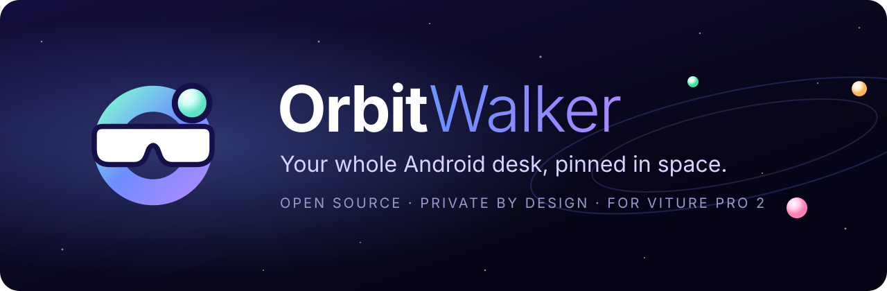
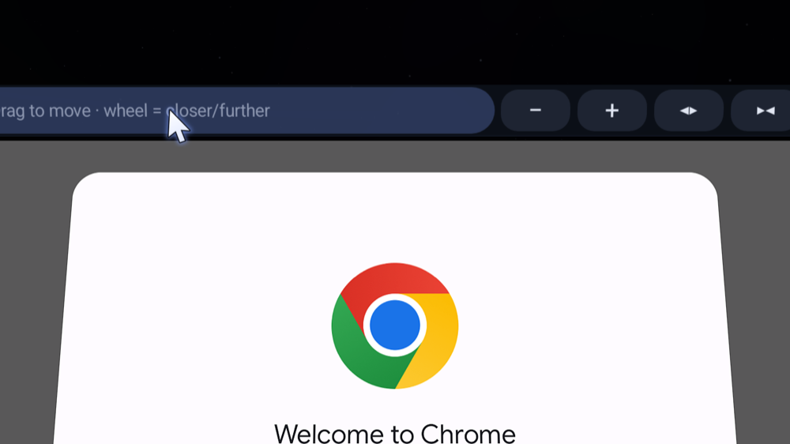
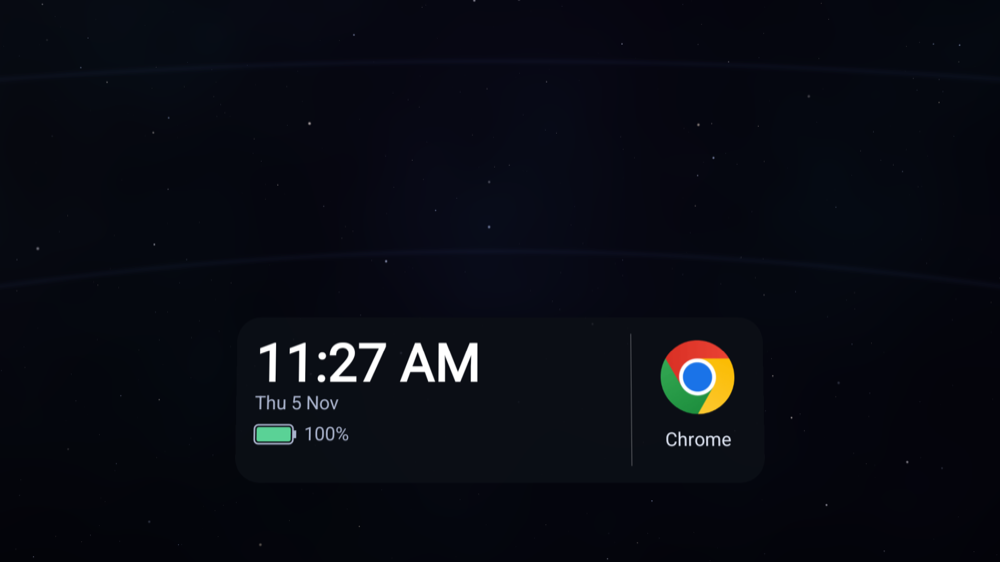
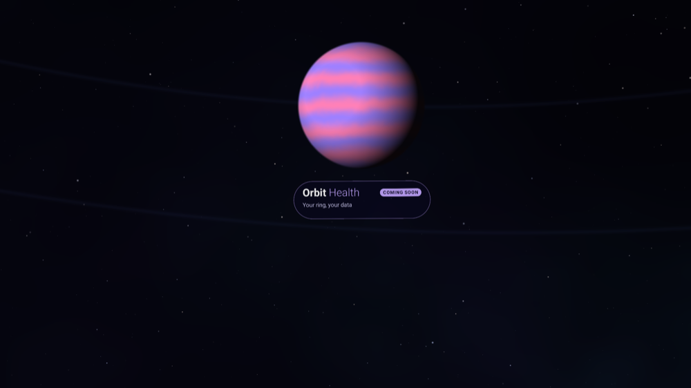
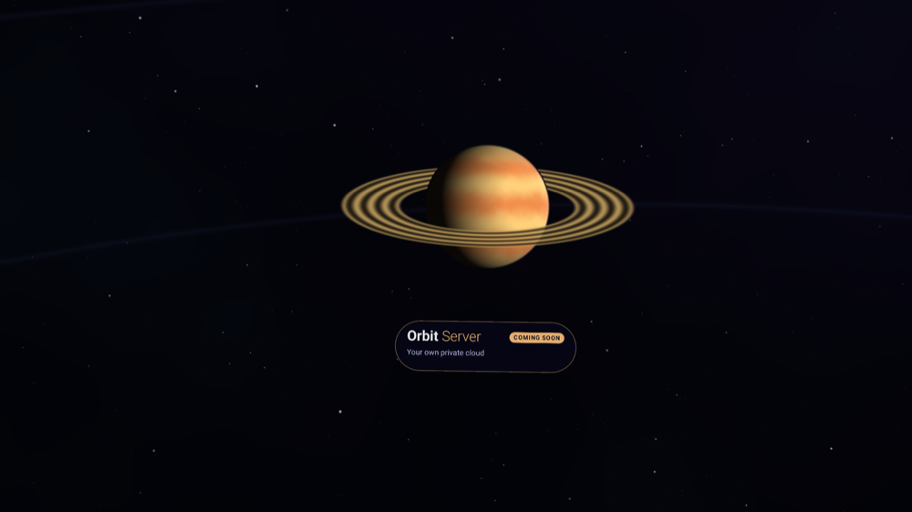

<p align="center">
  
</p>

<p align="center">
  <a href="LICENSE"></a>
  
  
  
  
</p>

<p align="center">
  <b>Every Android app on its own floating screen. Head-tracked, keyboard and mouse ready, no DeX, no cloud, no account.</b>
</p>

---

OrbitWalker turns your phone and a pair of **VITURE Pro 2** XR glasses into a **multi-monitor desk that stays put in space**. Open up to ten apps side by side, look around to move between them, and drive them with a Bluetooth keyboard and mouse. It's a travel workstation that fits in a pocket.

VITURE's glasses stream their motion sensors, but on Android their own app only pins its built-in screens, and Samsung DeX can't be pinned at all. OrbitWalker does the head tracking on the phone and gives **any app** its own pinned screen.

> **Part of the Orbit family**: open-source, local-first apps that keep your data on your own devices. One promise across all of them: *your hardware, your data, no vendor cloud in the middle.*

## In the glasses

| | |
|---|---|
|  |  |
| **Arrange with your mouse.** Drag a screen's title bar to move it; resize, push back, reset or close it from the bar. | **Dock under the centre screen.** Clock, date, phone battery and your recent apps, one click away. |
|  |  |
| **The Orbit sky.** A calm solar system circles you. Planets drift under 0.2° a second, or stay completely still. | **The family, as planets.** Each planet is an upcoming Orbit app. |

*Captured from the glasses' output on the Android emulator test rig.*

## Features

**A real multi-screen desk**
- Up to **10 app screens**: side by side on a gentle curve, then a second row above.
- **Head-tracked pinning** in every direction, with drift calibration, motion prediction and one-tap **Recenter**. Pinned or Follow mode.
- **You control the layout**: distance, size, gap and height, plus per-screen move, push/pull and resize, all saved.
- **Pixel-perfect sizing** and Sharp/Ultra screen resolutions for crisp text.

**Keyboard and mouse first**
- **Bluetooth keyboard and mouse** drive the glasses directly: click, drag, scroll and right-click Back, with typing in every app, passwords included.
- A **status card** shows where each device is going (glasses or phone) and why keys aren't arriving, if they aren't.
- **Ctrl+Esc** hands the keyboard and mouse back to the phone.
- An **in-glasses keyboard** and a full-screen **phone trackpad** when you're away from your desk kit.

**Made for long sessions**
- **Eye care**: a reminder every 20 minutes (adjustable) to look far away, and a real-break nudge after 90 minutes. Never during a film.
- **Comfort by design**: the sky moves slower than clouds, there's a **Still sky** switch, and nothing in the scene swims with your head.
- **Notifications** as cards in the glasses (optionally without their text).

**Watch and play**
- **Cinema mode** for Netflix, Prime Video, Disney+ and other protected video, with play, pause and seek from the phone.
- **3D desk**: true side-by-side stereo, plus 3D video support per screen.
- **Mirror mode** shows your phone screen pinned in space, with no setup at all.

**Private by design**
- No accounts, no analytics, no ads, no cloud. Network use stays on your phone: it talks to its own Wireless debugging service, and that's it.
- Everything runs on the phone: the head tracking, the window management and the input handling.

## How OrbitWalker gets its powers

Putting other apps on virtual screens needs Android's debugging-level ("shell") permissions. Tools like Shizuku provide them; **OrbitWalker has its own built-in helper**, so it's the only app you need:

1. Turn on **Developer options** and connect to Wi-Fi.
2. In OrbitWalker: **Set up → Pair**, then type the 6-digit code from *Wireless debugging → Pair device with pairing code* into OrbitWalker's notification.
3. OrbitWalker starts its helper. It keeps running until the phone restarts.

On **Samsung** phones, the app first takes you to **Auto Blocker** so you can switch it off for a while; you can switch it back on once the helper is running. After a phone restart you only tap **Start**: no new pairing.

The helper accepts calls only from OrbitWalker itself, and after an update it only follows the same signed app. No root is needed, and Samsung Knox isn't tripped.

## Requirements

| | |
|---|---|
| **Glasses** | VITURE Pro 2 (USB `35CA:1300/1301`). Other VITURE models are untested. |
| **Phone** | Android 13 or newer with USB-C video out (DisplayPort Alt Mode). Tested on a Samsung Galaxy Z Fold. |
| **Samsung** | Turn off DeX, so the glasses act as a plain external display. |
| **VITURE SpaceWalker** | Installed from Google Play: OrbitWalker uses VITURE's own glasses libraries from it (see below). |

## Getting OrbitWalker

**Builds aren't published yet.** OrbitWalker talks to the glasses through VITURE's own native libraries, which are proprietary and can't be redistributed. The next release will load them from your installed copy of VITURE SpaceWalker instead of bundling them; signed APKs will appear under [Releases](../../releases) then.

Until then, you can build it yourself from your own copy of SpaceWalker:

```bash
# Requirements: JDK 17+, Android SDK 35
# 1. Get SpaceWalker's APK from your own phone
adb shell pm path com.viture.spacewalker      # then: adb pull <path> SpaceWalker.apk
# 2. Extract VITURE's libraries into app/src/main/jniLibs (gitignored, never committed)
scripts/extract-viture-libs.sh SpaceWalker.apk
# 3. Build and install
./gradlew testDebugUnitTest assembleDebug
adb install app/build/outputs/apk/debug/app-debug.apk
```

Release builds read their signing key from `~/.gradle/gradle.properties` (`ORBIT_RELEASE_*`); without it they fall back to the debug key.

## How it works

```
VITURE Pro 2 ──USB──▶ VITURE native libs ──raw IMU──▶ orientation filter (bias calibration, prediction)
                                                           │ head pose
OrbitWalker helper (shell uid) ─ virtual display per app ─▶ OpenGL ES scene on the glasses
        ▲  taps, drags, keys, scroll                          (screens placed by the layout model)
        └──── Bluetooth keyboard/mouse or phone trackpad ─▶ pointer ray ─▶ the right pixel on the right screen
```

| Folder | What's inside |
|---|---|
| `glasses/` | USB and VITURE SDK bring-up, IMU parsing |
| `tracking/` | Orientation filter, recenter, prediction |
| `layout/` | Screen arrangement, pointer ray and hit testing, dock and title bar (pure, unit-tested) |
| `render/` | The glasses scene: screens, sky, dock, cards, stereo |
| `helper/` | Wireless-debugging pairing and the built-in shell helper |
| `shell/` | The helper's service: virtual displays, input injection, raw Bluetooth input |
| `input/` | Keyboard and mouse mapping, status |
| `ui/` | The Jetpack Compose phone app |

`scripts/emulator/` holds the test rig used during development: an Android emulator with a simulated glasses display and a virtual Bluetooth keyboard and mouse.

## Roadmap

**OrbitWalker**
- Signed releases that use VITURE's libraries from your installed SpaceWalker, so nothing proprietary is bundled.
- 2D → 3D conversion of ordinary video with an on-device depth model.
- Saved layouts per task, and more glasses as the community asks for them.

**The Orbit family**: apps for the cheap smart devices in our lives, without the vendor cloud.

| App | The idea |
|---|---|
| **Orbit Health** | Your smart ring's data on your phone, not a vendor's server. |
| **Orbit Secure** | Cheap cameras and doorbells, recorded to your own space. |
| **Orbit Home** | Smart plugs and bulbs controlled locally, no vendor account. |
| **Orbit Server** | One box you own, instead of a subscription per vendor. |
| **Orbit Agents** | Your own AI on your own hardware, under rules you set. |

A home for all of them, **The Orbit Apps**, is on its way, with downloads and guides for every app.

## Contributing

Thank you for the interest! **Contributions aren't open yet**: the project is still being set up and maintainer time is limited, so pull requests can't be reviewed for now. They will open soon. In the meantime, feedback is very welcome: open an issue with your glasses, phone and what you saw (Settings → **Share logs** helps a lot). See [CONTRIBUTING.md](CONTRIBUTING.md).

To report a security problem privately, see [SECURITY.md](SECURITY.md).

Video guides: [youtube.com/@Kno2gether](https://www.youtube.com/@Kno2gether)

## License

[Apache-2.0](LICENSE) for OrbitWalker's own code. Third-party components are listed in [NOTICE](NOTICE).

VITURE's libraries are not included and remain VITURE's property. OrbitWalker is an independent project, not affiliated with or endorsed by VITURE or Samsung. *VITURE*, *SpaceWalker*, *Samsung*, *Galaxy* and *DeX* are trademarks of their owners.
